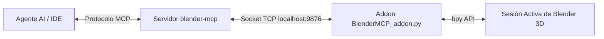

# Skill de Arquitectura de Casas y Control de Blender vía MCP

Este documento establece la **Skill de Arquitectura Residencial (Casas y Viviendas Bifamiliares)** y el **Protocolo de Integración y Conexión con Blender mediante MCP (Model Context Protocol)**.

---

## PARTE 1: Guía y Criterios del Arquitecto Residencial (Skill de Arquitectura)

### 1. Principios de Diseños y Zonas
* **Zona de Día (PB / Principal)**:
  * **Salón - Comedor**: Mínimo 20-25 m². Debe priorizarse la orientación Sur/Este con ventilación directa y conexión visual/física con patios o terrazas.
  * **Cocina**: Integrada u abierta con isla/península (10-15 m²). Circulación fluida en triángulo de trabajo (Zona de agua, cocción y almacenamiento).
* **Zona de Noche (PA / Franja Tranquila)**:
  * **Dormitorio Principal**: Mínimo 12-14 m² + Baño en suite y vestidor integrados.
  * **Dormitorios Secundarios**: Mínimo 9-10 m² por dormitorio individual/doble con armario empotrado (mínimo 60 cm de profundidad).
* **Servicios y Circulación**:
  * **Escaleras**: Ancho mínimo 90-100 cm. Huella: 28-30 cm, Contrahuella: 16.5-17.5 cm (Relación de Blondel: $2CH + H = 62..64\text{ cm}$).
  * **Aseo de Visitas**: Mínimo 1.5-2.0 m².

### 2. Normativa de Habitabilidad y Dimensiones Libres
* **Altura libre entre forjados**:
  * Altura de planta utilizable: 2.60 m a 2.70 m.
  * Baños y pasillos: Altura mínima con falso techo de 2.30 m - 2.40 m.
* **Huecos y Luz Natural**:
  * La superficie acristalada de ventilación/iluminación debe ser como mínimo el **10% - 12% de la superficie útil** de cada estancia habitada.
  * Uso de carpinterías de aluminio o PVC con RPT (Rotura de Puente Térmico) y doble/triple vidrio bajo emisivo.

### 3. Criterios de Renderizado y Expresión Gráfica (3D / BIM)
* **Materiales PBR Realistas**:
  * Uso de texturas PBR con mapa de rugosidad (Roughness), relieve/normal (Bump/Normal) y reflectividad adecuada (Metalness/Specular).
  * Parquet o gres porcelánico en interiores, estucos minerales en fachadas, panelados de madera natural en detalles cálidos.
* **Iluminación Físicamente Correcta**:
  * Sol dinámico con cielo físico (Nishita / Hosek-Wilkie) ajustado a latitud/hora solar.
  * Emisión de luz interior cálida (2700K - 3000K) en focos encastrados, tiras LED foseadas y lámparas decorativas.
* **Cámaras Cónicas y Perspectiva de Ojo Humano**:
  * Cámaras a 1.60m - 1.70m de altura respecto al nivel de suelo.
  * Desplazamiento vertical (Shift Y) para mantener líneas verticales totalmente paralelas sin distorsión de fugas de 3 puntos.

---

## PARTE 2: Conexión e Integración con Blender mediante MCP (Model Context Protocol)

### 1. Arquitectura de Conexión


### 2. Configuración en `opencode.json`
El proyecto ya cuenta con el servidor MCP configurado en `opencode.json`:
```json
{
  "mcp": {
    "blender-mcp": {
      "type": "local",
      "command": ["C:\\Users\\Oscar Martinez\\.local\\bin\\uvx.exe", "--python", "3.11", "blender-mcp"],
      "enabled": true,
      "env": {
        "BLENDER_HOST": "localhost",
        "BLENDER_PORT": "9876",
        "DISABLE_TELEMETRY": "true"
      }
    }
  }
}
```

### 3. Pasos para Activar la Conexión Interactiva
1. **Abrir Blender**: Ejecutar Blender (GUI o CLI en fondo).
2. **Cargar el Addon**: Instalar o ejecutar `tools/BlenderMCP_addon.py` en Blender.
3. **Iniciar el Servidor TCP en Blender**: En la pestaña lateral (3D Viewport -> Sidebar `N`), hacer clic en **"Start MCP Server"** (Puerto 9876).
4. **Ejecución Directa de Comandos**: El cliente MCP enviará scripts y manipulaciones directamente a Blender en tiempo real, permitiendo:
   - Crear, modificar y transformar geometrías y parámetros BIM.
   - Ajustar luces, cámaras y encuadres en tiempo real.
   - Modificar nodos de Shader PBR y compositor.
   - Lanzar renderizados automáticos y capturar vistas previas.

---

## PARTE 3: Mejoras Aplicadas y Futuras para el Proyecto `mi-casa`

1. **Estructura y Geometría 3D**:
   - Ajustes de muros, tabiquerías y carpinterías mediante el motor paramétrico `blender_lib.py`.
   - Incorporación de elementos decorativos (vegetación realista, pérgola en patio, falso techo foseado).
2. **Materiales PBR & Shaders**:
   - Mejora del mapa de relieve y mezcla de rugosidades en estuco, madera y vidrios reflectantes.
3. **Presentación Gráfica**:
   - Automatización de renders en alta resolución (2560x1440) con AgX/Filmic Tone Mapping.
   - Exportación de planos PDF con carátula normalizada y cuadro de superficies según normativa.
